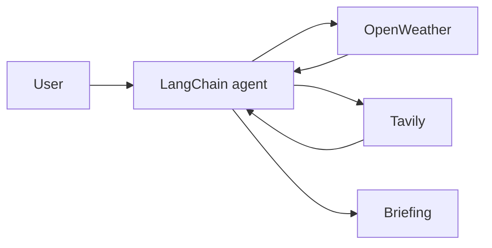

# City Intelligence Agent

A Streamlit AI agent that retrieves city weather and news using LangChain, Groq, OpenWeather and Tavily.

## Setup

```bash
python -m venv .venv
# Activate the environment
pip install -r requirements.txt
```

Set `GROQ_API_KEY`, `OPENWEATHER_API_KEY` and `TAVILY_API_KEY` in a local `.env` file.

```bash
streamlit run app.py
```

## Architecture

User query → LangChain agent → weather/news tools → city briefing.

The weather tool currently targets Indian cities. Verify source URLs and timestamps; model availability depends on your account.

## Evaluation

Test weather-only, news-only, combined and ambiguous queries, invalid cities, provider timeouts and missing credentials. Record tool-call accuracy and latency before claiming performance.

## Repository overview

Tool-calling AI agent for Indian city weather and recent news using Groq, Tavily and OpenWeather.

**Suggested GitHub topics:** `ai-agents` `tool-calling` `groq` `tavily` `openweather` `langchain` `streamlit`.

## System architecture


